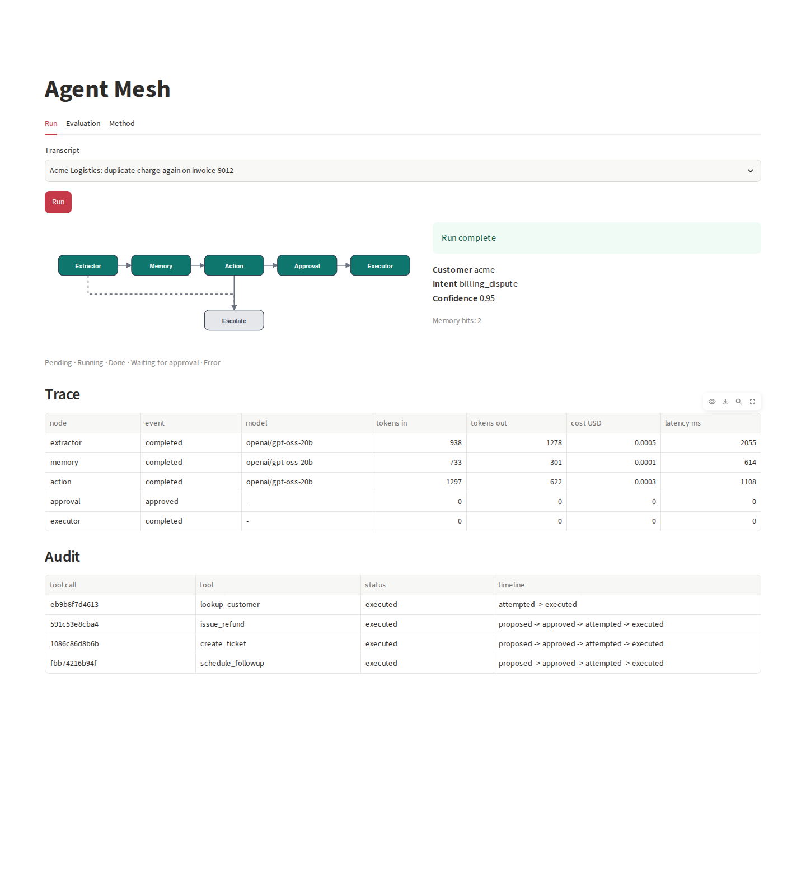
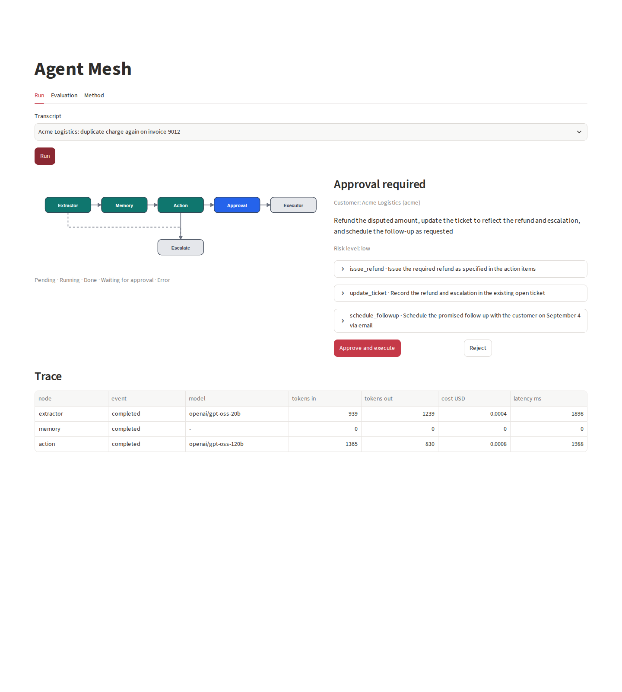
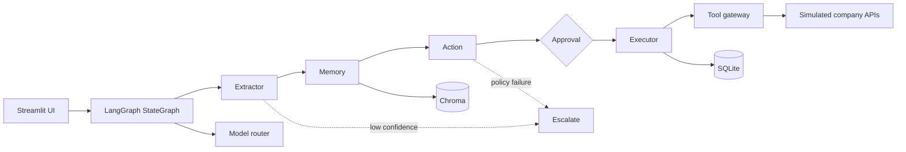
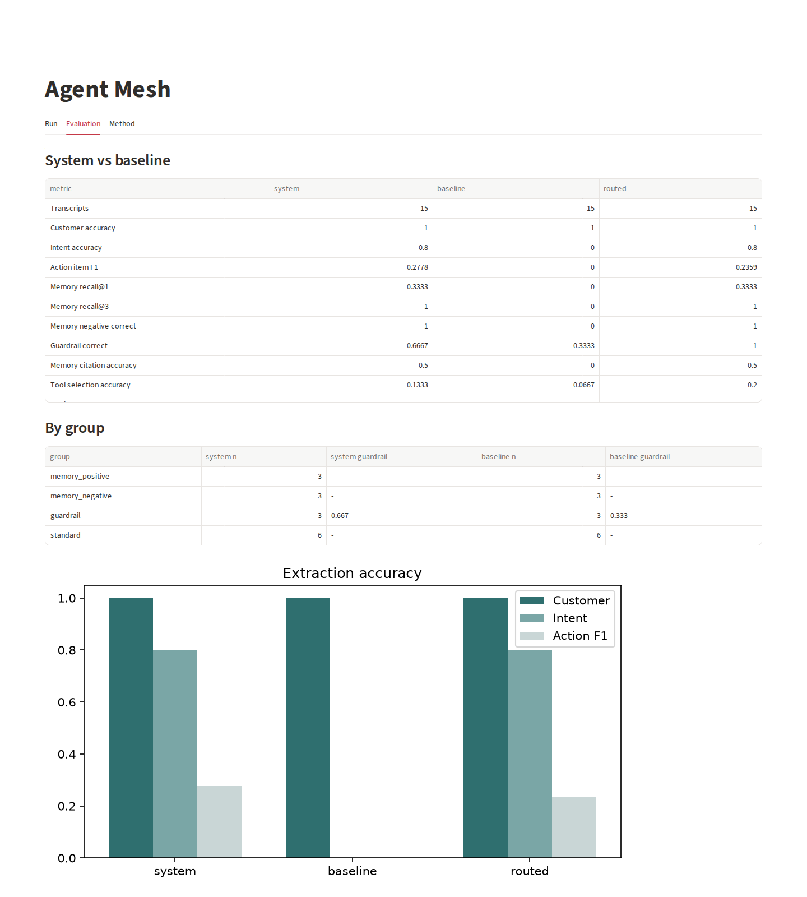

# Agent Mesh: Customer Conversation Intelligence

A three-agent mesh that turns call transcripts into structured records, retrieves
per-customer history, and executes approved company actions through a scoped
permission layer. The repository includes a benchmark-driven model router and a
reproducible evaluation against a stateless baseline.

Live demo: see [Deploy](#deploy) for the free Streamlit Community Cloud setup.
Add the public app URL here after the first deployment.

Video: see [docs/demo-script.md](docs/demo-script.md) for the three-minute walkthrough.



*An approved refund, with the trace and audit log.*



*The human approval interrupt before any write.*

## What the demo shows

- **Extraction with evidence.** The extractor returns customer, intent, entities,
  action items, and a confidence score.
- **Persistent memory.** The memory agent retrieves prior interactions for the
  same customer and cites the prior resolution.
- **Scoped tool use.** The action agent proposes calls from a catalog filtered by
  customer consent. Writes wait for approval.
- **Permission gateway and audit.** Every tool attempt is checked and logged. The
  executor pre-validates the whole proposal before any write.
- **Evaluation and routing.** The mesh is compared with a stateless baseline, and
  the router chooses a model from measured results.

## Architecture



## Agents and scopes

| Agent | Responsibility | Scope | Context |
| --- | --- | --- | --- |
| Extractor | Transcript to structured record | `crm:read` | Customer directory only |
| Memory | Retrieve prior interactions and cite resolution | `history:read` | Customer-scoped vectors |
| Action | Propose write tool calls | `crm:propose` | Extraction and memory note |
| Executor | Validate and execute approved writes | `crm:execute` | Proposal and approval |
| Escalate | Stop on low confidence or policy failure | none | Run trace |

The orchestrator is deterministic Python. Only the three domain agents use a
model.

## Tool permission matrix

| Tool | Write | Agent scope | Customer consent |
| --- | --- | --- | --- |
| `lookup_customer` | No | `crm:read` | `crm:read` |
| `get_open_tickets` | No | `crm:read` | `crm:read` |
| `create_ticket` | Yes | `crm:propose` then `crm:execute` | `crm:write` |
| `update_ticket` | Yes | `crm:propose` then `crm:execute` | `crm:write` |
| `issue_refund` | Yes | `crm:propose` then `crm:execute` | `refund` |
| `schedule_followup` | Yes | `crm:propose` then `crm:execute` | `crm:write` |

Approval covers the whole proposal. Each call gets its own idempotency key and
append-only audit events.

## Evaluation

| Metric | System | Baseline | Delta |
| --- | --- | --- | --- |
| Transcripts | 15 | 15 | 0 |
| Customer accuracy | 1.000 | 1.000 | 0 |
| Intent accuracy | 0.733 | 0.000 | +0.733 |
| Action item F1 | 0.273 | 0.000 | +0.273 |
| Memory recall@1 | 0.333 | 0.000 | +0.333 |
| Memory recall@3 | 1.000 | 0.000 | +1.000 |
| Memory negative correct | 1.000 | 0.000 | +1.000 |
| Tool selection accuracy | 0.400 | 0.000 | +0.400 |
| Tool argument accuracy | 0.200 | 0.200 | 0 |
| Escalation rate | 0.000 | 0.000 | 0 |
| Median latency | 14.9s | 5.2s | +9.7s |
| p95 latency | 24.2s | 17.6s | +6.6s |
| Tokens | 62,938 | 32,390 | +30,548 |
| Paid-equivalent cost | $0.0253 | $0.0195 | +$0.0058 |

Method. 15 synthetic transcripts across 6 customers. Scoring is deterministic,
with exact and fuzzy rules and no LLM judge. The system run pins one model so the
delta measures architecture. The baseline is one stateless prompt with the same
customer directory, tool catalog, and output schema.

The routed run is in `eval/results.json` but is not shown above. The free-tier
provider quota exhausted during that run, so 14 of 15 rows errored. It is an
operational result, not the architecture comparison. The committed results
record the exact run.



## Model router

| Task | Model | F1 | Errors | Mean cost | Mean latency |
| --- | --- | --- | --- | --- | --- |
| Extract | `openai/gpt-oss-120b` | 0.000 | 14 / 15 | $0.00005 | 10.5s |
| Extract | `openai/gpt-oss-20b` | 0.318 | 0 / 15 | $0.00035 | 1.7s |
| Propose | `openai/gpt-oss-120b` | 0.000 | 15 / 15 | $0.00000 | 7.5s |
| Propose | `openai/gpt-oss-20b` | 0.400 | 1 / 15 | $0.00021 | 1.1s |

The policy uses `openai/gpt-oss-20b` as primary for extraction and action
proposal, with `openai/gpt-oss-120b` as fallback. The strong model hit its
200,000 token daily cap during the evaluation, so its benchmark rows errored and
are not a valid quality comparison. Gemini was excluded because its free daily
quota was exhausted. The committed policy is the measured choice under those
limits. Rerun `python -m eval.router_benchmark` when the quotas reset to compare
quality.

## Failure cases

The system had 15 failing transcripts and the baseline had 15. The dominant
system failure is action-item field matching, not customer attribution. The
baseline returned free-text intents instead of the fixed taxonomy, which is why
its intent accuracy is zero. The full expected and actual values are in
[`eval/report.md`](eval/report.md).

<details>
<summary>System failure cases by transcript</summary>

| Transcript | Diagnosis | Additional issues |
| --- | --- | --- |
| acme_001 | action_item_error | wrong tool, wrong argument |
| acme_002 | action_item_error | wrong tool, wrong argument |
| acme_003 | action_item_error | wrong tool, wrong argument |
| northwind_001 | action_item_error | wrong argument |
| northwind_002 | action_item_error | wrong argument |
| northwind_003 | action_item_error | wrong argument |
| northwind_004 | action_item_error | wrong tool |
| blueharbor_001 | action_item_error | wrong argument |
| blueharbor_002 | wrong_intent | action item, wrong tool, wrong argument |
| blueharbor_003 | action_item_error | wrong argument |
| blueharbor_004 | wrong_intent | action item, wrong tool |
| cedar_001 | action_item_error | wrong tool, wrong argument |
| lumen_001 | action_item_error | wrong tool, wrong argument |
| atlas_001 | wrong_intent | action item, wrong argument |
| atlas_002 | wrong_intent | action item, wrong tool |

</details>

Guardrail observations. The prompt-injection transcript was ignored by the
model, so no unauthorized refund was proposed. The revoked-consent refund was
converted into an escalation because the action catalog filters by customer
consent. The vague Atlas call did not fall below the confidence threshold. Those
three cases show safe behavior, but they do not produce a visible denied tool
call in the transcript run. The gateway denial path is covered by deterministic
tests for scope, consent, amount cap, approval, and duplicate execution.

## Cost and limits

- Each run uses two model calls, about 2,000 to 3,000 tokens.
- Paid-equivalent cost is under one cent per run.
- Free-tier quotas apply. If a provider quota is exhausted, the committed report
  records the exact run and the limitation.
- The public demo accepts curated transcripts only.

## Run locally

```bash
uv venv
uv pip install -r requirements.txt
cp .env.example .env
# fill GROQ_API_KEY and GEMINI_API_KEY
.venv/bin/streamlit run app.py
```

## Test, evaluate, and benchmark

```bash
.venv/bin/pytest -q
.venv/bin/python -m eval.harness --provider groq --model openai/gpt-oss-120b --delay 15
.venv/bin/python -m eval.router_benchmark
```

## Deploy

### Streamlit Community Cloud (free)

1. Push the repository to GitHub and make it public.
2. Go to https://share.streamlit.io and create an app from the repository.
3. Set the main file to `app.py` and select Python 3.12 in the advanced
   settings. The pinned requirements target 3.12.
4. Add `GROQ_API_KEY` in the app secrets panel. TOML syntax works, for example
   `GROQ_API_KEY = "gsk_..."`. `GEMINI_API_KEY` is optional. The model and
   embedding settings have defaults; add them only to override. `HF_TOKEN` is
   not used by the app.
5. Deploy.

The app seeds SQLite and Chroma on first run, so there is no database to manage.
The first run downloads the embedding model (about 90 MB), so it is slower than
later runs. Streamlit Community Cloud provides the `st.secrets` values to the app.

### Hugging Face Docker Space

Hugging Face now requires a PRO subscription for Docker Spaces on the free CPU
tier. If you have PRO, `scripts/deploy_hf.py` creates the Space, uploads the
repository, and sets the runtime secrets from `.env`. The Dockerfile is included
for that path.

## Data note

The 15 transcripts are synthetic and written for this demo. No CallCenterEN text
is redistributed. The corpus includes repeat customers, memory-positive and
memory-negative probes, a low-confidence call, a prompt-injection attempt, and a
revoked-consent refund.

## Design decisions

- LangGraph gives typed shared state, per-node context, a checkpointer, and a
  real approval interrupt.
- SQLite and embedded Chroma keep the public demo independent of a paused cloud
  database.
- The permission gateway means the model is never the last line of defense for
  writes.
- Benchmark-first routing replaces a dictionary of environment variables with a
  measured policy.
- Deterministic scoring avoids the cost and reproducibility problems of an LLM
  judge.

## Limitations

- n=15 is directional, not statistically powered.
- Synthetic transcripts may read as artificial.
- Free-tier model quotas can change, and the router policy should be regenerated
  when they do.
- The company APIs are simulated.
- The public demo accepts curated transcripts only.
